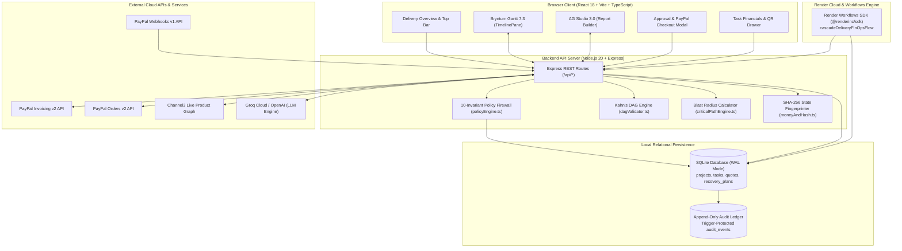
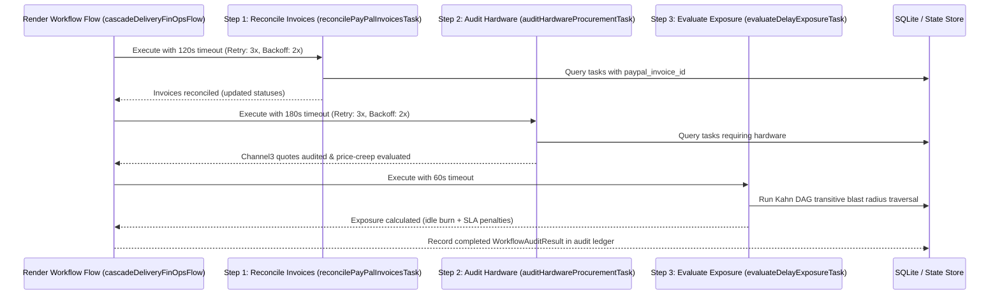

# CascadeOS: Payment-Aware Construction Delivery Operating System

> **"Every project runs on two clocks: schedule and money. CascadeOS keeps them in sync."**

CascadeOS connects critical-path construction schedules, procurement intelligence, automated PayPal milestone payments, and deterministic governance to prevent idle crew burn and compounding liquidated damages.

[](LICENSE)
[-emerald.svg)](#m-testing-and-verification)
[](tsconfig.base.json)
[](.node-version)
[](https://developer.paypal.com)
[](https://www.youtube.com/watch?v=cwtKS8jz7tI)
[](#2-ai-integration--openai-and-groq)
[](render.yaml)
[](https://trychannel3.com)
[](https://bryntum.com/products/gantt/)
[](https://www.ag-grid.com/studio/)

---

## Table of Contents

- [A. Hero Overview](#a-hero-overview)
- [B. The Problem](#b-the-problem)
- [C. The Solution — What CascadeOS Does](#c-the-solution--what-cascadeos-does)
- [D. See CascadeOS in Action](#d-see-cascadeos-in-action)
- [E. End-to-End Product Workflow](#e-end-to-end-product-workflow)
- [F. Technology Stack](#f-technology-stack)
- [G. Sponsor Integrations — Dedicated Deep Dives](#g-sponsor-integrations--dedicated-deep-dives)
  - [1. PayPal Developer Platform](#1-paypal-developer-platform)
  - [2. AI Integration — OpenAI and Groq](#2-ai-integration--openai-and-groq)
  - [3. Channel3 — Product Graph API](#3-channel3--product-graph-api)
  - [4. Bryntum Gantt 7.3](#4-bryntum-gantt-73)
  - [5. AG Grid / AG Studio 3.0](#5-ag-grid--ag-studio-30)
  - [6. Render Hosting & Render Workflows](#6-render-hosting--render-workflows)
  - [7. APIMatic](#7-apimatic)
  - [8. Postman](#8-postman)
- [H. Architecture](#h-architecture)
- [I. Render Workflows — Distributed FinOps Pipeline](#i-render-workflows--distributed-finops-pipeline)
- [J. Installation and Local Setup](#j-installation-and-local-setup)
- [K. Configuration and Integration Setup](#k-configuration-and-integration-setup)
- [L. Project Structure](#l-project-structure)
- [M. Testing and Verification](#m-testing-and-verification)
- [N. Security and Reliability Safeguards](#n-security-and-reliability-safeguards)
- [O. Current Limitations](#o-current-limitations)
- [P. Roadmap](#p-roadmap)
- [Q. License](#q-license)
- [R. Contributing and Support](#r-contributing-and-support)

---

## A. Hero Overview

Commercial construction and specialized buildouts are governed by two disconnected clocks:
1. **The Construction Schedule**: Critical-path Gantt charts, trade crew scheduling, and delivery dependencies.
2. **The Financial Pipeline**: Capital draws, milestone client invoices, and hardware procurement purchase orders.

When these clocks drift apart, disaster strikes: a delayed $4,500 milestone invoice halts work, leaving specialized crews idle on site ($1,200/day idle burn) and triggering compounding liquidated damages penalties ($1,440/day). Meanwhile, unvetted procurement introduces silent vendor price-creep (+28.95% over baseline).

**CascadeOS** bridges this divide. It couples live **PayPal Invoicing v2** and **PayPal Orders v2** directly to an interactive **Bryntum Gantt** timeline and **Kahn's algorithm Directed Acyclic Graph (DAG)** engine. It continuously monitors downstream financial blast-radius, detects supplier price-creep via the **Channel3 Product Graph**, identifies safe schedule promotions, and executes recovery plans protected by a **10-invariant fail-closed policy firewall** and **SHA-256 state-fingerprint binding**.

---

## B. The Problem

Traditional project management tools (Primavera P6, Microsoft Project, Asana, Monday.com) treat schedules and money as separate universes:

```
TRADITIONAL SILOED MODEL:
[ Project Schedule (Gantt) ]  -- (No Connection) --  [ Accounting / Billing (Invoices) ]
        |                                                     |
  Work halted on site                                   Invoice overdue 5 days
  Crews stand idle ($1,200/day)                         Accountant unaware of job site stoppage
  SLA penalties compound ($1,440/day)                   Owner surprised by delay notice
```

### The Real-World Breakdown:
* **Payment-Blocked Milestones**: A subcontractor cannot install specialized medical display brackets until the client pays the Phase 2 milestone invoice.
* **Idle Crew Burn**: Specialized union trades (electricians, mechanical technicians, AV engineers) cost $680 to $1,200 per day. If they cannot work because a preceding phase is blocked, their contractor still incurs idle labor costs.
* **Cascading Schedule Delays**: When a critical-path milestone slips by 3 days, downstream phases without float immediately inherit the delay, compounding into liquidated damages.
* **Supplier Price-Creep**: When hardware must be reordered urgently, suppliers often mark up items (+28.95% above historical baselines). Field managers approve these out of desperation because they lack instant multi-vendor pricing intelligence.

### The Central Question CascadeOS Answers:
> **"What should happen next on the job site, what will it cost right now, and is that action mathematically and contractually safe to execute?"**

---

## C. The Solution — What CascadeOS Does

CascadeOS introduces continuous, payment-aware project governance across 13 core capabilities:

| # | Capability | What It Does | Why It Matters | How It Works |
|---|---|---|---|---|
| **1** | **Payment-Coupled Milestones** | Maps every project task directly to a PayPal Invoicing v2 record with status tracking (`DRAFT`, `SENT`, `PAID`, `OVERDUE`). | Eliminates communication lag between billing and field crews. | Background sync reconciles PayPal invoice states directly into task scheduling properties. |
| **2** | **Dependency-Aware Scheduling** | Evaluates milestone dependencies using Kahn's topological sort and cycle-detection algorithm. | Prevents impossible schedule loops and guarantees valid execution order. | Traverses task dependency edges in SQLite and computes in-degree values to establish acyclic order. |
| **3** | **Financial Blast-Radius Analysis** | Computes cumulative downstream idle crew costs and contractual SLA penalties when a task slips. | Quantifies the exact dollar risk of every single day of delay. | Performs breadth-first transitive graph traversal from the blocked node, summing `daily_idle_burn_minor` and `sla_delay_penalty_minor`. |
| **4** | **Channel3 Price-Creep Detection** | Queries Channel3's Live Product Graph across real retail merchants to benchmark hardware quotes. | Stops contractors from overpaying for emergency replacement supplies. | Compares incumbent quotes against historical unit baselines. Flags price creep exceeding 10.00% (e.g., +28.95%). |
| **5** | **Deterministic Schedule Recovery** | Re-evaluates the Kahn DAG to identify independent, warehouse-ready tasks that can be promoted immediately. | Keeps field crews productive while a blocked invoice is sorted out. | Finds candidate tasks where all predecessors are `COMPLETED` and `materials_in_warehouse === 1`, shifting dates to preserve project opening. |
| **6** | **Fail-Closed Policy Firewall** | Enforces 10 deterministic mathematical and financial invariants before any action is approved. | Guarantees that neither AI nor human error can execute an illegal or out-of-budget action. | Evaluates budget caps, price variance, currency match, and predecessor completion. Returns `ALLOW`, `REQUIRE_APPROVAL`, or `BLOCK`. |
| **7** | **SHA-256 Approval Binding** | Computes a canonical SHA-256 hash over the project state, proposed reroute dates, and order totals. | Prevents race conditions and guarantees that what the manager reviewed is what gets executed. | The approval endpoint verifies `signed_fingerprint === canonical_hash`. If state mutated in the interim, it aborts with HTTP 409. |
| **8** | **PayPal Invoicing & Checkout** | Provisions live PayPal Sandbox invoices with partial-payment unlock thresholds and executes Orders v2 checkouts. | Allows clients to unlock materials upfront without paying 100% of deferred labor immediately. | Calls PayPal Invoicing v2 to set `allow_partial_payment: true` with a minimum amount due, and generates Base64 payment QR codes. |
| **9** | **AI FinOps Assistant & Nudge-Bot** | Leverages `openai/gpt-oss-120b` on Groq (or OpenAI `gpt-4o`) with strict JSON schema outputs. | Assists managers with natural-language project planning and drafts non-confrontational client payment nudges. | Generates acyclic project DAGs from English prompts, explains policy blocks, and drafts email nudges embedding PayPal payment links. |
| **10** | **Render Workflows Pipeline** | Orchestrates distributed background FinOps audits using the `@renderinc/sdk/workflows` engine. | Ensures scheduled health checks, invoice reconciliation, and price audits run durably with retries. | Runs a 3-task sequential flow: `reconcile-invoices → audit-channel3-procurement → evaluate-blast-radius` with exponential backoff. |
| **11** | **Bryntum Gantt 7.3 Integration** | Renders an interactive, payment-styled Critical Path Method (CPM) timeline with live drag-and-drop. | Gives site superintendents a familiar, enterprise-grade Gantt interface. | Uses `@bryntum/gantt-react` with custom status badges (`PAYMENT BLOCKED`, `READY TO PROMOTE`), syncing edits to SQLite. |
| **12** | **AG Studio 3.0 Analytics** | Mounts embedded AG Grid report builder and dashboard views with custom FinOps widgets. | Provides financial controllers with real-time tabular analysis and cross-filtering. | Integrates `ag-studio-react` with custom `CascadeRecoveryWidget` and `FriendlyNudgeScoreboardWidget` validated via Zod. |
| **13** | **Append-Only Audit History** | Records every schedule change, policy decision, approval, and PayPal API call in SQLite. | Provides an immutable-by-trigger operational audit trail for dispute resolution. | SQLite triggers abort any `UPDATE` or `DELETE` attempt on `audit_events`, guaranteeing append-only history. |

---

## D. See CascadeOS in Action

### Demo Video Walkthrough

[](https://www.youtube.com/watch?v=cwtKS8jz7tI)

▶ **[Click to Watch the Full CascadeOS Demo on YouTube (2:52)](https://www.youtube.com/watch?v=cwtKS8jz7tI)**

> *This demo covers all 7 acts and sponsor integrations in under 3 minutes, following the exact production script in [`CASCADEOS_DEMO_SCRIPT.md`](CASCADEOS_DEMO_SCRIPT.md).*

### Product Walkthrough Showcase

```
+--------------------------------------------------------------------------------------------------+
|                                    1. DELIVERY OVERVIEW                                          |
|                                                                                                  |
| [Screenshot Placeholder: Delivery Overview & Project Switcher]                                   |
| Relative Path: client/public/screenshots/01-delivery-overview.png                                |
| Summary: Bento KPI cards (Critical Path Exposure, Overdue Invoices, Savings Realized) alongside  |
| active milestone registers, crew assignments, and payment status badges.                        |
+--------------------------------------------------------------------------------------------------+
|                                  2. BRYNTUM GANTT 7.3 TIMELINE                                   |
|                                                                                                  |
| [Screenshot Placeholder: Interactive Bryntum Gantt Timeline]                                     |
| Relative Path: client/public/screenshots/02-bryntum-gantt.png                                    |
| Summary: Full WBS critical-path scheduling with color-coded FinOps pills (Red = Payment Blocked, |
| Emerald = Promoted Active, Indigo = Ready to Promote), drag-and-drop dependency links.          |
+--------------------------------------------------------------------------------------------------+
|                               3. CHANNEL3 SUPPLIER PROCUREMENT                                   |
|                                                                                                  |
| [Screenshot Placeholder: Channel3 Price Arbitrage & Creep Detection]                             |
| Relative Path: client/public/screenshots/03-channel3-procurement.png                             |
| Summary: Live comparison table showing Incumbent quote ($490.00/unit, +28.95% creep) blocked by  |
| policy vs. Channel3 live OEM search ($349.00/unit), realizing $564.00 net project savings.       |
+--------------------------------------------------------------------------------------------------+
|                             4. RECOVERY PLANS & POLICY FIREWALL                                  |
|                                                                                                  |
| [Screenshot Placeholder: Kahn DAG Recovery Plan & 10-Invariant Diff]                             |
| Relative Path: client/public/screenshots/04-recovery-policy-diff.png                             |
| Summary: Side-by-side schedule diff displaying Phase 3 promotion, Phase 2 deferral, mitigated    |
| idle burn, and the green 10-point fail-closed policy checklist.                                  |
+--------------------------------------------------------------------------------------------------+
|                            5. PAYPAL CHECKOUT & INVOICE SPLIT MODAL                              |
|                                                                                                  |
| [Screenshot Placeholder: PayPal Smart Buttons & Invoice QR Display]                              |
| Relative Path: client/public/screenshots/05-paypal-checkout-qr.png                               |
| Summary: In-context PayPal JS SDK button checkout for Channel3 hardware ($1,396.00) alongside   |
| the live PayPal Sandbox Invoicing v2 partial-payment QR code for mobile scanning.               |
+--------------------------------------------------------------------------------------------------+
|                               6. AI FINOPS ASSISTANT & NUDGE-BOT                                 |
|                                                                                                  |
| [Screenshot Placeholder: Conversational Copilot & Payment Nudge Preview]                         |
| Relative Path: client/public/screenshots/06-ai-finops-assistant.png                              |
| Summary: Natural-language project investigation chat powered by Groq/OpenAI, showing the drafted |
| empathetic client payment email with partial materials unlock and live PayPal link.              |
+--------------------------------------------------------------------------------------------------+
|                             7. AG STUDIO 3.0 ANALYTICS DASHBOARD                                 |
|                                                                                                  |
| [Screenshot Placeholder: AG Studio 3.0 Embedded Report Builder]                                  |
| Relative Path: client/public/screenshots/07-ag-studio-analytics.png                              |
| Summary: Enterprise grid with custom CascadeRecoveryWidget, live pivot tables, and cross-filter  |
| drill-downs linking project milestones directly to ledger line items.                            |
+--------------------------------------------------------------------------------------------------+
|                                  8. APPEND-ONLY AUDIT TRAIL                                      |
|                                                                                                  |
| [Screenshot Placeholder: SQLite Append-Only Audit Ledger]                                        |
| Relative Path: client/public/screenshots/08-audit-trail-ledger.png                                |
| Summary: Chronological, trigger-protected audit log showing SHA-256 state fingerprints, HTTP     |
| outbound calls with redacted secrets, user approvals, and export to Markdown/JSON.              |
+--------------------------------------------------------------------------------------------------+
```

---

## E. End-to-End Product Workflow

Consider the canonical project: **Apex Diagnostic Clinic & Studio Buildout** (a high-stakes medical facility with lead-lined X-ray enclosures and low-latency diagnostic displays).

```mermaid
flowchart TD
    A["1. Milestone Payment Overdue<br/>Phase 2 Invoice ($4,500) unpaid"] --> B["2. Kahn DAG Blast-Radius Analysis<br/>4 dependent phases stalled<br/>Cumulative Exposure: $5,100 ($3,660 idle crew + $1,440 SLA)"]
    B --> C["3. Incumbent Supplier Price-Creep<br/>Incumbent quotes $490/unit (+28.95% creep)"]
    C --> D{"4. Policy Firewall Gatekeeper<br/>server/src/engine/policyEngine.ts"}
    D -->|"BLOCK: VENDOR_PRICE_CREEP_EXCEEDED<br/>& TOTAL_EXCEEDS_PHASE_BUDGET"| E["5. Channel3 Live Product Graph Query<br/>Discovers OEM replacement at $349/unit<br/>Saves $564.00 (28.78% reduction)"]
    E --> F["6. Kahn Schedule Rerouting<br/>Phase 3 (Networking) is warehouse-ready (materials_in_warehouse === 1)<br/>Promote Phase 3 to active; Defer Phase 2"]
    F --> G["7. SHA-256 Fingerprint Plan Binding<br/>Canonical state hash: e.g. 7f8a...3d9c<br/>Prevents race conditions or state mutation"]
    G --> H["8. Superintendent Review & Sign-Off<br/>Decision: REQUIRE_APPROVAL -> ALLOW<br/>Fingerprint validated"]
    H --> I["9. PayPal Sandbox Execution<br/>- Invoice v2: Enable partial payment ($1,396 materials unlock)<br/>- Orders v2: Instant checkout order for Channel3 replacement"]
    I --> J["10. Append-Only Audit Logging<br/>SQLite trigger protects event ledger<br/>Webhook confirms capture -> DAG unblocks Phase 2"]
```



### Clarification on Kahn's Algorithm Boundary:
> **Important Distinction:** Kahn's topological sort establishes **valid dependency ordering** and guarantees that the schedule remains an acyclic directed graph. It does **not** independently verify whether materials are physically staged, whether an invoice is paid, or whether a crew is available. Those operational and financial constraints are strictly enforced by the **10-Invariant Policy Firewall** (`policyEngine.ts`).

---

## F. Technology Stack

| Layer | Technology | Version | Purpose in CascadeOS |
|---|---|---|---|
| **Frontend Framework** | React + Vite | React 18.3, Vite 5.4 | High-performance SPA with hot module reloading and optimized production bundling |
| **Language** | TypeScript | 5.6.3 | Strict static typing across entire monorepo (`exactOptionalPropertyTypes`, `noUncheckedIndexedAccess`) |
| **Styling & UI** | Tailwind CSS + Lucide Icons | Tailwind 3.4 | Polished, responsive design system supporting seamless Dark and Light themes |
| **Gantt Scheduling** | Bryntum Gantt | 7.3.7 (`@bryntum/gantt-react`) | Interactive critical-path timeline, dependency links, drag-drop scheduling, and custom FinOps pills |
| **Analytics & Data Grid** | AG Studio & AG Grid | 3.0.0 (`ag-studio-react`) | Self-serve business intelligence, custom FinOps widgets, cross-filtering, and report builder |
| **Backend Runtime** | Node.js + Express | Node 20.18, Express 4.21 | REST API routes, webhook listeners, and deterministic business logic |
| **Database** | SQLite + better-sqlite3 | SQLite 3 (WAL mode) | Local persistent relational database with foreign keys enabled and trigger-enforced append-only audit log |
| **Payments & Invoicing** | PayPal Developer Platform | Invoicing v2, Orders v2 | Milestone split invoices, partial payment unlocks, QR code generation, and supplier checkout orders |
| **Agentic Payments** | `@paypal/agent-toolkit` | 1.0.0 | Native PayPal agent tool wrappers (`list_invoices`, `get_invoice`, `send_invoice_reminder`) for LLMs |
| **Procurement Intelligence**| Channel3 Product Graph | v0 / v1 REST API | Live multi-retailer catalog search, price-creep auditing, and hardware SKU verification |
| **AI / LLMs** | Groq Cloud / OpenAI | `openai/gpt-oss-120b` / `gpt-4o` | AI Project Architect DAG generation, payment nudge drafting, and policy explanations |
| **Background Orchestration**| Render Workflows | `@renderinc/sdk` 1.8.0 | Durable background FinOps audit pipeline with automatic retries and exponential backoff |
| **Cloud Hosting** | Render | Node Web Service | Cloud hosting with 10GB persistent disk for SQLite data safety across redeploys |
| **API Architecture** | APIMatic | Typed OpenAPI Pipeline | Type-safe PayPal API transport models generated from official OpenAPI specifications |
| **Testing** | Vitest + Testing Library | Vitest 2.1.4 | 210 deterministic unit and integration tests across server and client workspaces |

---

## G. Sponsor Integrations — Dedicated Deep Dives

### 1. PayPal Developer Platform

CascadeOS implements an authentic, zero-mock integration with the **PayPal Sandbox environment** (`https://api-m.sandbox.paypal.com`), ensuring that every financial interaction mirrors real enterprise operations.

* **PayPal Invoicing API v2 (`server/src/services/paypalInvoicingService.ts`)**:
  * **Automated Milestone Invoicing**: On project creation, CascadeOS automatically generates and sends live PayPal Sandbox invoices for milestone deliverables (e.g., Phase 2 Diagnostic Imaging Buildout: `$4,500.00`).
  * **Dynamic Partial-Payment Unlocking**: When a client invoice default stalls the critical path, CascadeOS updates the invoice via `PUT /v2/invoicing/invoices/{id}` with `configuration.partial_payment`:
    ```json
    {
      "allow_partial_payment": true,
      "minimum_amount_due": { "currency_code": "USD", "value": "1396.00" }
    }
    ```
    This allows the client to unlock the physical hardware ($1,396.00) so materials can ship, while deferring the labor portion ($3,104.00) until installation commences.
  * **Base64 Payment QR Code Generation**: Calls `POST /v2/invoicing/invoices/{id}/generate-qr-code` to generate a 300x300 Base64 PNG QR code rendered directly in the `TaskFinancialsDrawer` and `ApprovalCheckoutModal`.
  * **Automated Invoice Reminders**: Calls `POST /v2/invoicing/invoices/{id}/remind` with personalized, context-aware notes when a phase's schedule float approaches zero.

* **PayPal Orders API v2 (`server/src/services/paypalOrdersService.ts`)**:
  * **Supplier Procurement Checkout**: Creates live PayPal Orders (`POST /v2/checkout/orders`) with `intent: 'CAPTURE'` when expedited replacement hardware is ordered from alternative suppliers via Channel3.
  * **Idempotency Guarantees**: Sends a unique `PayPal-Request-Id` derived from the recovery plan's SHA-256 fingerprint, ensuring network retries cannot double-charge.

* **`@paypal/agent-toolkit` (`server/src/services/paypalAgentToolkitBridge.ts`)**:
  * Exposes native PayPal agent tools (`list_invoices`, `get_invoice`, `send_invoice_reminder`, `generate_invoice_qr_code`, `get_merchant_insights`) to autonomous LLM agents.
  * **Security Boundary**: The LLM is granted read and reminder tools only; financial creation and payment capture are strictly gated behind human superintendent approval.

* **PayPal React SDK (`@paypal/react-paypal-js`)**:
  * Embedded in `client/src/components/ApprovalCheckoutModal.tsx` for seamless, in-context PayPal Smart Button checkout using sandbox credentials.

* **PayPal Webhooks API v1 (`server/src/routes/webhookRoutes.ts`)**:
  * Listens for `INVOICING.INVOICE.PAID` and `CHECKOUT.ORDER.APPROVED`. Verifies HMAC-SHA256 webhook signatures using PayPal public certificates, automatically transitioning task states in SQLite and unblocking dependent DAG nodes.

> **Demonstration Figures:**
> * Total Phase 2 Invoice: **$4,500.00** (`450000` minor units)
> * Materials Allocation: **$1,396.00** (`139600` minor units)
> * Deferred Labor Portion: **$3,104.00** (`310400` minor units)
> 
> *Note: All transactions run in the PayPal Developer Sandbox. No real-world funds are charged.*

---

### 2. AI Integration — OpenAI and Groq

CascadeOS integrates state-of-the-art LLMs via the OpenAI-compatible SDK, configured to run either **`openai/gpt-oss-120b` on Groq Cloud** (for ultra-fast, sub-second inference) or **OpenAI `gpt-4o`** with strict structured outputs.

* **AI Project Architect (`server/src/services/projectArchitectAiService.ts`)**:
  * Accepts free-form English project briefs (e.g., *"Build an 8-room diagnostic clinic with lead-lined X-ray rooms by December 15th"*).
  * Uses **Strict JSON Schema Outputs** (`response_format: { type: 'json_schema' }`) to generate complete, multi-phase project blueprints with task durations, crew names, daily idle burn rates ($1,200/day), invoice budgets, and Channel3 search queries.
  * All generated blueprints are subjected to Kahn's algorithm cycle-detection before any database persistence occurs.

* **Collaborative AI Nudge-Bot (`server/src/services/nudgeAndFinOpsAiService.ts`)**:
  * When a milestone invoice is overdue, the Nudge-Bot ingests the exact financial facts (total invoice `$4,500.00`, materials unlock `$1,396.00`, daily crew burn `$1,200/day`).
  * Generates an empathetic, non-confrontational email to the property owner explaining how paying just the $1,396 materials portion prevents job-site delays and saves thousands in idle labor.

* **FinOps Policy Advisor**:
  * When the policy firewall blocks an action (e.g., vendor price-creep or unfulfilled dependencies), this service generates an executive-level plain-English briefing with actionable remediation steps.

* **AG Studio 3.0 Copilot (`server/src/routes/studioAgentRoutes.ts`)**:
  * Answers natural-language project questions from project managers inside the analytics dashboard in real time.

> **Human-in-the-Loop Safety Rule:** AI generates recommendations, drafted communications, and blueprint proposals. The deterministic policy engine and human managers retain exclusive authority over schedule mutations and PayPal transactions.

---

### 3. Channel3 — Product Graph API

CascadeOS integrates the **Channel3 Live Product Graph API** (`server/src/services/channel3Service.ts`) to provide live market pricing for construction materials.

* **Live Multi-Merchant Search**: Queries Channel3 (`POST /search` or `GET /v0/search`) using natural-language construction queries (e.g., `"4K Ultra-HD Medical Diagnostic Displays"` or `"commercial electrical conduit 1-inch"`).
* **Price-Creep Defense**: When an incumbent supplier attempts to increase prices from historical baselines ($380.00 to $490.00/unit, a +28.95% increase), CascadeOS flags the violation against its 10.00% variance policy ceiling.
* **Automated OEM Arbitrage**: Searches Channel3 for equivalent replacement inventory, locating supplier inventory at $349.00/unit. For a 4-unit requirement, this produces an immediate net project savings of **$564.00 (28.78% savings)**.
* **Deterministic Caching**: Caches supplier quotes in SQLite (`supplier_quotes` table) to maintain high performance during offline demonstrations.

---

### 4. Bryntum Gantt 7.3

The project schedule is visualized and managed via **Bryntum Gantt 7.3** (`client/src/components/TimelinePane.tsx`), the industry gold-standard for web-based CPM scheduling.

* **Payment-Coupled Timeline**: Milestone bars display live FinOps status pills (`PAID`, `PAYMENT BLOCKED`, `READY TO PROMOTE`, `REROUTED ACTIVE`).
* **Critical Path Highlighting**: Dynamically computes and highlights the project critical path, showing managers exactly which tasks have zero schedule float.
* **Interactive Drag & Resize Synchronization**: Moving task bars or resizing durations triggers `onAfterTaskDrop` and `onAfterTaskEdit` events that update the backend via `PATCH /api/projects/:id/tasks/:taskId`, re-running the critical-path engine immediately.
* **Bi-Directional Filtering**: Double-clicking any milestone bar opens the `TaskFinancialsDrawer`, synchronizing the active task across the 3D topology and AG Studio analytics.

---

### 5. AG Grid / AG Studio 3.0

CascadeOS embeds **AG Studio 3.0** (`client/src/studio/StudioWorkspace.tsx`), providing financial controllers with a self-serve reporting environment directly inside the application.

* **Embedded Report Builder & Dashboard**: Mounts `<AgStudio />` in both interactive builder (`mode="edit"`) and executive presentation (`mode="view"`) modes.
* **Custom Registered FinOps Widgets (`client/src/studio/widgets/createCascadeWidgets.ts`)**:
  * **`CascadeRecoveryWidget`**: Displays active recovery plans, vendor price comparisons, and policy diffs with live cross-filtering across data grid rows.
  * **`FriendlyNudgeScoreboardWidget`**: Visualizes invoice payment statuses, Base64 PayPal QR codes, and AI-drafted nudges.
* **Zod Format Validation**: All custom widget schemas are strictly validated using Zod, ensuring zero runtime rendering crashes.
* **Studio Agent Framework**: Integrates the `cascade-finops-agent` delegating to AG Studio's built-in `data` and `widget` agents.

---

### 6. Render Hosting & Render Workflows

CascadeOS leverages Render for both cloud infrastructure and distributed task execution:

#### Render Cloud Hosting
* Deployed as a Node.js web service running in the Oregon region (`render.yaml`).
* Configured with a **10GB persistent disk** (`/var/data`) mounted at `/var/data/cascade_os.sqlite`, guaranteeing that project state, recovery plans, and audit ledgers persist across restarts and zero-downtime deploys.
* Node runtime pinned to **`20.18.0`** for native C++ binary compatibility with `better-sqlite3`.

#### Render Workflows Orchestration (`@renderinc/sdk/workflows`)
* Implemented in `server/src/workflows/finopsWorkflow.ts`.
* Coordinates long-running, multi-step FinOps milestone audits asynchronously across distributed workers.
* See [Section I](#i-render-workflows--distributed-finops-pipeline) for the complete workflow architecture.

---

### 7. APIMatic

During development, CascadeOS utilized **APIMatic's Context Plugin** and SDK tooling to ingest the official PayPal Invoicing v2 and Orders v2 OpenAPI specifications (`docs/apimatic.md`):

* **Typed API Transport**: Generated strongly typed request and response contracts located in `server/src/services/paypalClient.ts`, eliminating runtime schema mismatches.
* **Regeneration Pipeline**: Shipped with an automated shell script (`server/scripts/generate-paypal-client.sh`) that consumes PayPal OpenAPI definitions and outputs typed transport bindings.
* **Zero Runtime Overhead**: Development-time SDK generation ensures the production server runs lean without external compiler dependencies.

---

### 8. Postman

Postman was used throughout development for API contract design, mock server verification, and automated regression testing:

* **Endpoint Testing Collection**: Validated all REST endpoints across project onboarding, task patching, scenario execution, and policy evaluation.
* **Webhook Simulation**: Used Postman to simulate asynchronous PayPal payment notifications (`INVOICING.INVOICE.PAID`) to test the automated Kahn DAG unblocking engine.

---

## H. Architecture



---

## I. Render Workflows — Distributed FinOps Pipeline

In production construction environments, scanning hundreds of project tasks for overdue invoices, querying live vendor pricing, and computing transitive graph exposures is too computationally intensive for synchronous HTTP request cycles.

CascadeOS implements **Render Workflows** (`@renderinc/sdk/workflows`) in [`server/src/workflows/finopsWorkflow.ts`](server/src/workflows/finopsWorkflow.ts) to run distributed background audits:



### Workflow Task Specifications:
1. **`reconcilePayPalInvoicesTask`**:
   * Plan: `starter` | Timeout: 120 seconds
   * Automatic Retries: 3 attempts with exponential backoff (`waitDurationMs: 1000`, `backoffScaling: 2`).
   * Polls PayPal Sandbox for active invoice status changes (`SENT` → `PAID`).
2. **`auditHardwareProcurementTask`**:
   * Plan: `starter` | Timeout: 180 seconds
   * Automatic Retries: 3 attempts with exponential backoff (`waitDurationMs: 1500`, `backoffScaling: 2`).
   * Queries Channel3 across all pending hardware tasks to refresh pricing and catch price creep before orders are locked.
3. **`evaluateDelayExposureTask`**:
   * Plan: `starter` | Timeout: 60 seconds
   * Executes Kahn DAG traversal to calculate cumulative idle crew hours and contractual SLA exposure.
4. **`cascadeDeliveryFinOpsFlow` (Parent Orchestrator)**:
   * Plan: `standard` | Timeout: 300 seconds
   * Chains the three steps sequentially, passing project context and returning a unified `WorkflowAuditResult`.

---

## J. Installation and Local Setup

### Prerequisites
* **Node.js**: `>= 20.11.0` (Recommended: `20.18.0` via nvm)
* **npm**: `>= 10.0.0`
* **Git**: Installed and configured
* **C++ Compiler**: Xcode Command Line Tools (macOS) or `build-essential` (Linux) for compiling `better-sqlite3`.

### 1. Clone the Repository
```bash
git clone https://github.com/viscous-236/cascaseOS.git
cd cascadeOS
```

### 2. Install Monorepo Dependencies
```bash
npm install
```

### 3. Configure Environment Variables
Copy the example environment template:
```bash
cp .env.example .env
```

Review and populate your `.env` variables:

| Variable | Required? | Purpose & Description |
|---|:---:|---|
| `PORT` | Optional | Backend API port (Default: `4000`) |
| `DATABASE_PATH` | Optional | Path to SQLite database (Default: `./server/data/cascade_os.sqlite`) |
| `PAYPAL_ENV` | Required | Set to `sandbox` for development and hackathon evaluation |
| `PAYPAL_API_BASE_URL` | Required | PayPal Sandbox URL (`https://api-m.sandbox.paypal.com`) |
| `PAYPAL_CLIENT_ID` | Required | PayPal Sandbox REST App Client ID from developer.paypal.com |
| `PAYPAL_CLIENT_SECRET` | Required | PayPal Sandbox REST App Client Secret |
| `PAYPAL_SANDBOX_MERCHANT_EMAIL` | Required | US Business Sandbox account email (e.g. `sb-...@business.example.com`) |
| `PAYPAL_SANDBOX_BUYER_EMAIL` | Optional | Sandbox buyer personal account email |
| `PAYPAL_WEBHOOK_ID` | Optional | Webhook ID for PayPal webhook signature verification |
| `CHANNEL3_API_KEY` | Required | API key for Channel3 Live Product Graph |
| `CHANNEL3_API_BASE_URL` | Optional | Base URL for Channel3 API (`https://api.trychannel3.com/v1`) |
| `GROQ_API_KEY` | Optional* | API key for Groq Cloud inference (Ultra-fast LLM runner) |
| `OPENAI_API_KEY` | Optional* | API key for OpenAI (`gpt-4o`) if not using Groq |
| `OPENAI_MODEL` | Optional | LLM model identifier (Default: `openai/gpt-oss-120b` or `gpt-4o`) |
| `VITE_PAYPAL_CLIENT_ID` | Required | Client-side PayPal Client ID (mirrors `PAYPAL_CLIENT_ID`) |

*\*Note: Provide either `GROQ_API_KEY` or `OPENAI_API_KEY`. The server automatically selects Groq when `GROQ_API_KEY` is present.*

### 4. Run Full Stack in Development Mode
Start both the Express backend (port 4000) and the Vite frontend (port 5173) with hot reloading:
```bash
npm run dev
```

Open your browser to: **`http://localhost:5173`**

### 5. Build and Run in Production Mode
Compile the TypeScript server and build the optimized client bundle:
```bash
npm run build
npm start
```

Access the unified production server at: **`http://localhost:4000`**

---

## K. Configuration and Integration Setup

### 1. PayPal Sandbox Application Setup
1. Log in to the [PayPal Developer Dashboard](https://developer.paypal.com).
2. Under **Apps & Credentials**, click **Create App** (Select Platform Type: *Merchant*, Sandbox).
3. Ensure the app is connected to a **US Business Account** (required by PayPal for Invoicing partial payment support).
4. Copy the **Client ID** and **Secret** into `PAYPAL_CLIENT_ID`, `PAYPAL_CLIENT_SECRET`, and `VITE_PAYPAL_CLIENT_ID`.
5. Set `PAYPAL_SANDBOX_MERCHANT_EMAIL` to your sandbox business account email.

### 2. PayPal Webhook Configuration
1. In your PayPal Sandbox App settings, click **Add Webhook**.
2. Enter your webhook endpoint URL (e.g., `https://your-domain.com/api/webhooks/paypal`).
3. Select the events:
   * `Invoicing invoice paid` (`INVOICING.INVOICE.PAID`)
   * `Checkout order approved` (`CHECKOUT.ORDER.APPROVED`)
4. Copy the generated Webhook ID into `PAYPAL_WEBHOOK_ID`.

### 3. Channel3 API Credentials
1. Obtain your API key from [Channel3](https://trychannel3.com).
2. Set `CHANNEL3_API_KEY=your_key_here` in `.env`.

### 4. Groq / OpenAI LLM Credentials
* **For Groq (Fastest):** Sign up at [Groq Console](https://console.groq.com), generate an API key, and set `GROQ_API_KEY=gsk_...` with `OPENAI_MODEL=openai/gpt-oss-120b`.
* **For OpenAI:** Generate an API key at [OpenAI Platform](https://platform.openai.com) and set `OPENAI_API_KEY=sk-...` with `OPENAI_MODEL=gpt-4o`.

---

## L. Project Structure

```text
cascadeOS/
├── client/                               # React 18 + Vite Frontend Workspace
│   ├── src/
│   │   ├── api/                          # Strongly typed backend API client
│   │   ├── components/                   # UI Components & Application Modals
│   │   │   ├── workspace/                # Workspace views (Overview, Suppliers, Dependencies)
│   │   │   ├── ApprovalCheckoutModal.tsx # PayPal Smart Buttons & Policy Diff Modal
│   │   │   ├── AuditDrawer.tsx           # Append-only audit trail viewer
│   │   │   ├── FinOpsWidgetPanel.tsx     # Recovery plans, blast radius & scenario triggers
│   │   │   ├── NewProjectModal.tsx       # AI Project Architect & Manual DAG builder
│   │   │   ├── TaskFinancialsDrawer.tsx  # Task scheduling, warehouse staging & PayPal QR
│   │   │   └── TimelinePane.tsx          # Bryntum Gantt 7.3 interactive integration
│   │   ├── context/                      # React State & Project Switcher context
│   │   ├── studio/                       # AG Studio 3.0 Custom Widgets & Workspace
│   │   └── types/                        # Domain models & integer minor-unit types
│   └── tests/                            # Vitest frontend component & contract tests
├── server/                               # Node.js + Express Backend Workspace
│   ├── data/                             # SQLite persistent storage (cascade_os.sqlite)
│   ├── src/
│   │   ├── config/                       # Zod environment variable validation (env.ts)
│   │   ├── db/                           # Database schema (schema.sql) & repository (database.ts)
│   │   ├── engine/                       # Deterministic Financial & Algorithmic Engines
│   │   │   ├── criticalPathEngine.ts     # Transitive blast radius & exposure analysis
│   │   │   ├── dagValidator.ts           # Kahn's in-degree topological sorter & cycle detector
│   │   │   ├── policyEngine.ts           # 10 fail-closed invariant firewall
│   │   │   └── scheduleRerouter.ts       # DAG schedule recovery recalculation
│   │   ├── routes/                       # Express REST endpoints & Webhook handlers
│   │   │   ├── projectRoutes.ts          # Project CRUD, task patching & AI architect route
│   │   │   ├── recoveryRoutes.ts         # Plan generation, approval & PayPal order capture
│   │   │   ├── scenarioRoutes.ts         # Deterministic scenario A/B/C simulation triggers
│   │   │   ├── studioAgentRoutes.ts      # AG Studio AI agent tool execution routes
│   │   │   └── webhookRoutes.ts          # PayPal webhook signature verification
│   │   ├── services/                     # External Sponsor Integrations
│   │   │   ├── channel3Service.ts        # Channel3 Live Product Graph integration
│   │   │   ├── nudgeAndFinOpsAiService.ts# AI payment nudge & policy explanation service
│   │   │   ├── paypalAgentToolkitBridge.ts # @paypal/agent-toolkit AI SDK bridge
│   │   │   ├── paypalAuthService.ts      # PayPal OAuth2 token caching
│   │   │   ├── paypalClient.ts           # APIMatic-validated typed PayPal transport
│   │   │   ├── paypalInvoicingService.ts # PayPal Invoicing v2 & QR generation
│   │   │   ├── paypalOrdersService.ts    # PayPal Orders v2 checkout & capture
│   │   │   └── projectArchitectAiService.ts # Natural-language project blueprint generator
│   │   ├── utils/                        # Integer money math, SHA-256 hashing & redaction
│   │   └── workflows/                    # Render Workflows SDK Background Tasks
│   │       └── finopsWorkflow.ts         # Distributed 3-step FinOps audit flow
│   └── src/__tests__/                    # Vitest backend integration & unit test suites
├── docs/                                 # Technical architecture & integration notes
├── CASCADEOS_DEMO_SCRIPT.md              # 2:52 hackathon video pitch script
├── render.yaml                           # Render Infrastructure-as-Code deployment blueprint
├── package.json                          # npm monorepo workspaces root
└── tsconfig.base.json                    # Base TypeScript compiler configuration
```

---

## M. Testing and Verification

CascadeOS enforces strict quality gates. All **210 tests pass (100%)** across the monorepo:

```bash
# Run server test suite (190 tests)
npm test --workspace=server

# Run client test suite (20 tests)
npm test --workspace=client

# Run static typecheck across all workspaces (0 errors)
npm run typecheck
```

### Verified Test Suite Breakdown:

```text
 ✓ server/src/engine/__tests__/engine.test.ts (43 tests)
   - Kahn DAG blast radius calculation & transitive exposure
   - Scenario A: Phase 3 promotion (REQUIRE_APPROVAL -> ALLOW)
   - Scenario B: Incumbent price-creep BLOCK (+28.95% vs 10% ceiling)
   - Scenario C: Adversarial dependency bypass & fail-closed invariants
 ✓ server/src/engine/__tests__/dagValidator.test.ts (6 tests)
   - Linear chain, diamond graph, and cycle rejection (A -> B -> A)
 ✓ server/src/__tests__/channel3Service.test.ts (4 tests)
   - Multi-vendor search, quote auditing, and SQLite caching
 ✓ server/src/__tests__/paypalClient.test.ts (6 tests)
   - Typed transport, token scope isolation, audit logging, and secret redaction
 ✓ server/src/__tests__/paypalAuthScopes.test.ts (6 tests)
   - Invoicing scope validation and token expiry caching
 ✓ server/src/__tests__/dynamicProjectsIntegration.test.ts (6 tests)
   - Multi-tenant project switching and dynamic DAG persistence
 ✓ server/src/__tests__/verifyLiveSandbox.test.ts (11 tests)
   - Live sandbox fail-closed guarantees and invoice lifecycle
 ✓ server/src/__tests__/onboardingAndCrud.test.ts (4 tests)
 ✓ server/src/__tests__/phase1.test.ts (48 tests)
 ✓ server/src/__tests__/phase3.test.ts (26 tests)
 ✓ server/src/__tests__/phase4.test.ts (6 tests)
 ✓ server/src/__tests__/apiIntegration.test.ts (15 tests)
 ✓ server/src/__tests__/studioAgentGrounding.test.ts (2 tests)

 ✓ client/tests/api-contract.test.ts (4 tests)
 ✓ client/tests/checkoutFlow.test.tsx (4 tests)
   - PayPal SDK button click -> backend order creation -> capture by plan ID
 ✓ client/tests/studioAgent.test.ts (3 tests)
 ✓ client/tests/widgets.test.tsx (9 tests)
   - AG Studio 3.0 custom widgets formatShape validation & cross-filtering
```

### Live Sandbox Verification Runner
To execute a genuine network test against the live PayPal Sandbox and Channel3 API:
```bash
npm run verify:sandbox
```
*Guarantees: Fails closed if any endpoint returns a placeholder ID, missing price, or unhandled rejection.*

---

## N. Security and Reliability Safeguards

CascadeOS implements defense-in-depth across the entire execution lifecycle:

1. **Server-Side Secret Redaction (`server/src/utils/redaction.ts`)**:
   * Outbound HTTP headers, bearer tokens, and API credentials are automatically sanitized before any entry is committed to logs or the audit table (`SEC-008`).
2. **Deterministic Integer Minor-Unit Math (`server/src/utils/moneyAndHash.ts`)**:
   * All financial values are strictly processed as integer minor units (`139600` cents = `$1,396.00`). Floating-point arithmetic is strictly prohibited in financial paths to prevent penny rounding errors.
3. **Fail-Closed Unknown Cost Policy (`SEC-006`)**:
   * If a supplier quote returns null or undefined for tax or freight, the policy firewall automatically issues a `BLOCK` (`UNKNOWN_COST_FIELD`). The system never assumes missing costs are $0.
4. **PayPal Webhook HMAC-SHA256 Verification**:
   * Inbound webhook payloads are verified using PayPal certificates and signature headers (`PAYPAL-AUTH-ALGO`, `PAYPAL-TRANSMISSION-SIG`) before any task state is unblocked.
5. **SHA-256 State Fingerprinting & Stale Approval Protection**:
   * Plan approvals are cryptographically bound to a canonical hash of project state. If task dates or budgets mutate between proposal and approval, the transaction is rejected with HTTP 409 (`STALE_FINGERPRINT_APPROVAL`).
6. **Trigger-Enforced Append-Only Audit Trail**:
   * SQLite triggers (`abort_audit_events_update` and `abort_audit_events_delete`) abort any update or deletion attempt on `audit_events`, protecting historical compliance logs from tampering.
7. **Human-in-the-Loop Financial Gating**:
   * Autonomous AI agents are restricted to read and drafting tools. Payment creation and capture strictly require human superintendent sign-off.

---

## O. Current Limitations

In the interest of full technical transparency:
* **Sandbox Environment**: All PayPal workflows currently run against the PayPal Developer Sandbox. Transitioning to production requires PayPal compliance boarding and live OAuth app activation.
* **Warehouse Inventory Staging**: In this release, `materials_in_warehouse` is an operational boolean flag in SQLite toggled via the UI drawer or REST API. In production, this would be wired directly to physical RFID dock sensors or ERP webhooks.
* **Single-Tenant Local Auth**: The hackathon build demonstrates multi-project switching without multi-user password/SSO authentication. Enterprise deployment requires integrating Okta, Clerk, or Azure AD.
* **Local Database Engine**: Uses `better-sqlite3` on a persistent disk. For massive multi-region concurrency, migrating to PostgreSQL with row-level locking would be recommended.

---

## P. Roadmap

- [ ] **Smart Escrow & Milestone Verification**: Integrate PayPal multi-party split payouts with certified inspector signatures.
- [ ] **Physical Barcode / RFID Dock Check-In**: Mobile barcode scanning app to automatically flip `materials_in_warehouse` when delivery trucks unload.
- [ ] **Enterprise ERP Connectors**: Two-way schedule and budget synchronization with Procore, Autodesk Construction Cloud, and Oracle Primavera P6.
- [ ] **Predictive Lead-Time Intelligence**: Machine-learning models predicting supply-chain delays before purchase orders are placed.
- [ ] **Role-Based Access Control (RBAC)**: Distinct permissions for Site Superintendents, Project Managers, Subcontractors, and Property Owners.

---

## Q. License

This project is licensed under the **MIT License** — see the [LICENSE](LICENSE) file for details.

---

## R. Contributing and Support

We welcome contributions! Please follow these steps:
1. Fork the repository and create a feature branch (`git checkout -b feature/amazing-feature`).
2. Verify that all tests pass and code is strictly typed (`npm test && npm run typecheck`).
3. Commit your changes with clear, descriptive messages (`git commit -m 'feat: add ERP connector'`).
4. Push to your branch and submit a Pull Request.

For questions, issues, or hackathon review discussions, please open an issue on the [GitHub Repository](https://github.com/viscous-236/cascaseOS).

---

*Built with passion for the **PayPal AI Hackathon 2026**.*
